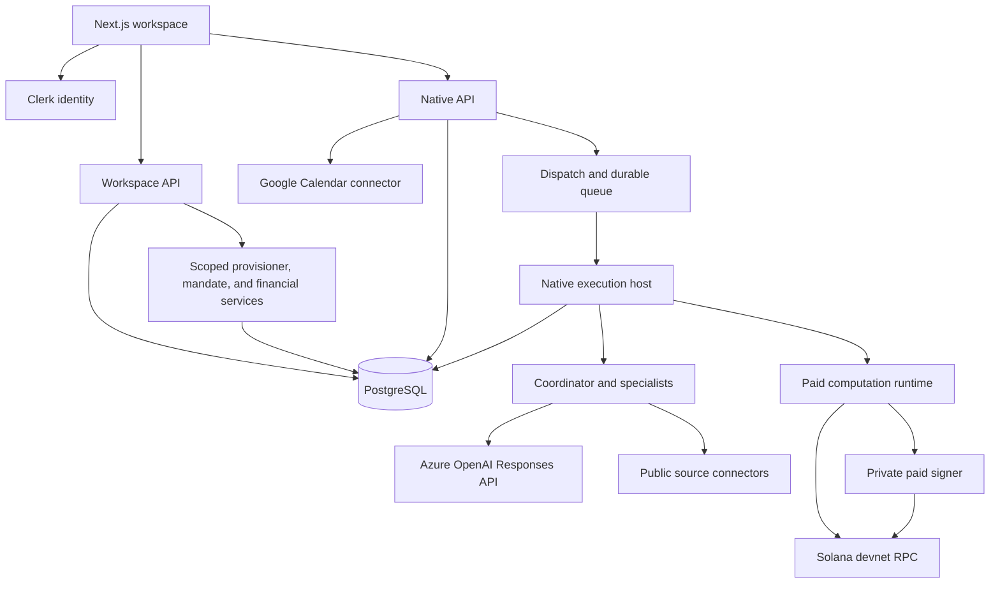

# Pactwoven

**One operator. A coordinated team of AI agents.**

[](https://github.com/richmondazadze/pactwoven/actions/workflows/ci.yml)

Pactwoven brings operational responsibilities, agent work, supplier handoffs, and financial decisions into one organization workspace. Describe the outcome, define the boundaries, follow the work, and review the decisions that need your authority.

A responsibility connects a site, service window, requirements, and acceptance criteria. Agents can research and plan around that context, while backend policies determine which actions are permitted. Versioned records, approval checks, and receipts keep the proposed plan connected to what actually happened.

**Status:** Development-stage software, currently version `0.1.0`. The repository includes working application flows, guarded service implementations, and controlled integration demos. Live capabilities depend on the services and credentials configured for a deployment; the complete supplier and financial execution lifecycle is still being developed.

## Contents

- [What the project supports](#what-the-project-supports)
- [Architecture](#architecture)
- [Repository structure](#repository-structure)
- [Technology and prerequisites](#technology-and-prerequisites)
- [Quick start](#quick-start)
- [Configure an authenticated workspace](#configure-an-authenticated-workspace)
- [Agent services and integrations](#agent-services-and-integrations)
- [API conventions](#api-conventions)
- [Development and verification](#development-and-verification)
- [Deployment](#deployment)
- [Solana program](#solana-program)
- [Troubleshooting](#troubleshooting)
- [Contributing and publication](#contributing-and-publication)
- [License](#license)

## What the project supports

| Area | Implemented scope |
| --- | --- |
| Organization workspace | Clerk authentication, organization onboarding, member access, site scope, and responsibility creation and review. |
| Mandates and approvals | Versioned mandate documents, proposal review, authority checks, step-up verification, and recovery of recorded operations. |
| Financial governance | Financial-policy drafting, preparation, versioned review, authorization, closure, provenance, and custody setup records. |
| Native agent work | Durable tasks, coordinator and specialist execution, work instructions, conversation, team activity, continuation, and controls. |
| Memory | Scoped memory records and notes connected to native work. |
| Google integration | Calendar connection and discovery, OAuth handling, encrypted token storage, and separate database capabilities. The current configuration is restricted to a designated development account. |
| Paid computation | A controlled equipment-optimizer demo with quotes, exact payment approval, private signing, settlement observation, and retained results and receipts. |
| Supplier protocols | Supplier identity, admission, relationships, scope policy, and observation/qualification implementations. Complete real-world supplier exchange remains in development. |
| Onchain custody | An Anchor program and generated TypeScript client for program configuration and custody initialization. |

The paid demo charges a **0.01 devnet USDC computation fee** against a controlled equipment catalogue. Its output is an equipment recommendation; it does not place an equipment order. The initialization-only custody program and the paid computation transfer are separate components.

A typical workflow is:

1. Create a responsibility with a site, time window, requirements, and a definition of completion.
2. Prepare or review the mandate and financial policy that apply to the work.
3. Start agent work and inspect its plan, sources, specialist contributions, and open questions.
4. Review an exact action when it requires additional authority or payment approval.
5. Follow the recorded outcome, supporting evidence, and any unresolved recovery state.

## Architecture

Pactwoven is a pnpm/Turborepo monorepo. Shared contracts define data exchanged across boundaries; deterministic domain functions enforce policy; repositories and services perform persistence and external effects.



The diagram shows the hosted service flow. Local development can run the workspace API and a polling coordinator without the hosted queue infrastructure.

The architecture enforces several boundaries:

- **Browser code uses contracts and authenticated HTTP.** It cannot import database repositories, privileged service runtimes, or signer implementations.
- **Contracts, domain policy, and adapters stay deterministic.** Provider requests, credentials, filesystem access, and database effects belong in service code.
- **Database capabilities are separate.** Runtime reads and writes, organization provisioning, mandates, financial authorization, native execution, and signing use purpose-specific roles and pools.
- **Authority is checked against current state.** Version checks, authority epochs, membership observations, and step-up evidence protect sensitive transitions.
- **A lost response preserves uncertainty.** Idempotency keys and original-operation recovery help resolve a prior attempt without creating a second commitment.
- **A model response does not authorize a payment.** Paid work binds approval and settlement evidence to the exact operation, with private signing isolated from the web and execution host.

The import graph is enforced by [check-boundaries.mjs](scripts/check-boundaries.mjs). PostgreSQL isolation, capability checks, and recovery behavior also have dedicated tests.

## Repository structure

| Path | Purpose |
| --- | --- |
| [`apps/web`](apps/web) | Next.js marketing site and authenticated organization workspace. |
| [`services/api`](services/api) | Hono workspace API, local Node entry point, and Cloudflare Workers for scoped authority services. |
| [`services/native-api`](services/native-api) | Native work, memory, voice, Google, and paid-work HTTP composition for Vercel. |
| [`services/native-host`](services/native-host) | Queue dispatch, task consumption, delegated execution, paid execution, and scheduled recovery. |
| [`services/coordinator`](services/coordinator) | Agent coordination, specialist work, model gateway, source evidence, and a local polling worker. |
| [`services/connectors`](services/connectors) | Public-source and Google provider transports and token-vault support. |
| [`services/paid-tools`](services/paid-tools) | Paid-tool protocol, equipment optimization, transfer construction, settlement checks, and delivery. |
| [`services/paid-signer`](services/paid-signer) | Private signing service with a separate database capability and executor identity. |
| [`packages/contracts`](packages/contracts) | Shared Zod schemas, request/response contracts, and domain types. |
| [`packages/domain`](packages/domain) | Approval, authority, policy, finance, supplier, and native-work rules. |
| [`packages/db`](packages/db) | PostgreSQL/Drizzle repositories, pool guards, and numbered SQL migrations. |
| [`packages/adapters`](packages/adapters) | Deterministic Solana decoding, token-account, and transaction-evidence helpers. |
| [`packages/service-identity`](packages/service-identity) | Service identity and workload-token verification. |
| [`packages/observability`](packages/observability) | Structured logging and redaction helpers. |
| [`packages/testkit`](packages/testkit) | Shared deterministic test utilities. |
| [`packages/security-patches`](packages/security-patches) | Reviewed dependency patch and its upstream legal notice. |
| [`programs/pactwoven`](programs/pactwoven) | Rust/Anchor custody program, generated client, and chain fixtures. |
| [`scripts`](scripts) | Build helpers, boundary/publication guards, dependency audit, and isolated CI database fixtures. |
| [`.github/workflows/ci.yml`](.github/workflows/ci.yml) | GitHub Actions verification and PostgreSQL integration jobs. |

## Technology and prerequisites

| Component | Technology |
| --- | --- |
| Workspace | pnpm `11.25.0`, Turborepo, TypeScript `7.0.2` |
| Web | Next.js `16.4.6`, React `19.3.1`, Tailwind CSS, Radix UI |
| Client data and forms | TanStack Query, React Hook Form, Zod |
| API and identity | Hono, Clerk, JOSE |
| Persistence | PostgreSQL, Drizzle ORM, `node-postgres` |
| Agent inference | Azure OpenAI Responses API |
| Hosted runtime | Cloudflare Workers/Hyperdrive and Vercel Functions/Queues/Schedules |
| Verification | Vitest and dedicated PostgreSQL integration fixtures |
| Optional chain development | Rust `1.95.0`, Anchor `1.2.2`, Solana CLI `4.1.2`, Codama |

For the basic preview, install Git, **Node.js `24.22.1`**, and **pnpm `11.25.0`**. Node `24.22.1` is pinned in [.node-version](.node-version) and used in CI; the root manifest also permits Node `^26.4.0`.

An authenticated workspace additionally needs PostgreSQL and a Clerk development application with organizations enabled. CI uses PostgreSQL `17.11`. Agent execution needs Azure model deployments; hosted queues, Google access, and paid computation have additional service-specific bindings.

Rust, Anchor, and Solana tooling are only needed when working on the onchain program or regenerating its client.

## Quick start

```bash
git clone https://github.com/richmondazadze/pactwoven.git
cd pactwoven

# After selecting the Node version from .node-version:
npm install --global pnpm@11.25.0
pnpm install --frozen-lockfile
pnpm dev
```

The root development command starts two processes:

| Process | Address |
| --- | --- |
| Web application | <http://127.0.0.1:3001> |
| Workspace API | <http://127.0.0.1:8787> |
| API health | <http://127.0.0.1:8787/health> |

Without credentials, the marketing pages and setup screens are available, and the API health endpoint reports that the process is alive. Protected workspace requests return setup-required responses until identity and database bindings are configured. Health is a liveness check, not confirmation that integrations are ready.

To run the processes independently:

```bash
pnpm --filter @pactwoven/web dev
pnpm --filter @pactwoven/api dev
```

## Configure an authenticated workspace

Environment files are intentionally ignored by Git, including samples. Create the following files locally and replace every placeholder with a value from your development setup.

### 1. Prepare PostgreSQL and run migrations

Create a dedicated database named **`pactwoven_dev`** on local PostgreSQL or Neon. Use a separate administrator/migration connection with enough permission to create schemas, roles, policies, and functions.

Save that connection URI in `.local/migration-database-url` using a local editor or secret manager, then run:

```bash
chmod 600 .local/migration-database-url

PACTWOVEN_MIGRATION_DATABASE=pactwoven_dev \
PACTWOVEN_MIGRATION_DATABASE_URL_FILE="$PWD/.local/migration-database-url" \
  pnpm exec tsx packages/db/src/migrate.ts
```

Create the `.local` directory before saving the file if it does not exist. The credential file must be a private regular file, without group or other permissions. For Neon, the migration URI must use `sslmode=verify-full` and a `neon.tech` hostname. Local migration connections must reach a loopback address.

The [migration runner](packages/db/src/migrate.ts) applies consecutive files from [packages/db/migrations](packages/db/migrations), verifies checksums against its journal, and uses an advisory lock and transaction. It accepts only `pactwoven_dev` and the dedicated `pactwoven_migration_test` fixture database. An existing application schema without a valid migration journal is rejected.

After migrations, create separate login roles for the two basic API capabilities. In an administrator `psql` session connected to `pactwoven_dev`:

```sql
CREATE ROLE pactwoven_dev_app LOGIN
  NOSUPERUSER NOCREATEDB NOCREATEROLE NOREPLICATION NOBYPASSRLS;
GRANT pactwoven_runtime TO pactwoven_dev_app;

CREATE ROLE pactwoven_dev_identity LOGIN
  NOSUPERUSER NOCREATEDB NOCREATEROLE NOREPLICATION NOBYPASSRLS;
GRANT pactwoven_provisioner TO pactwoven_dev_identity;
```

Set a separate password for each login with the interactive `psql` commands `\password pactwoven_dev_app` and `\password pactwoven_dev_identity`. Configure database connection privileges as required by your PostgreSQL installation. These logins must not own application schemas/tables or inherit administrator privileges.

### 2. Configure the web application

Create `apps/web/.env.local`:

```dotenv
NEXT_PUBLIC_API_BASE_URL=http://127.0.0.1:8787
NEXT_PUBLIC_CLERK_PUBLISHABLE_KEY=<clerk-development-publishable-key>
CLERK_SECRET_KEY=<clerk-development-secret-key>
```

Use the development key pair from the same Clerk application that the API will verify. Clerk organizations and an organization administrator are required for initial onboarding. Configure your Clerk application for the local web origin and the `/sign-in` and `/sign-up` routes.

### 3. Configure the workspace API

Create `services/api/.env.local`:

```dotenv
APP_ENVIRONMENT=development
PORT=8787
ALLOWED_ORIGINS=http://127.0.0.1:3001,http://localhost:3001
DATABASE_URL=<pactwoven-dev-app-connection-uri>
PROVISIONER_DATABASE_URL=<pactwoven-dev-identity-connection-uri>
CLERK_SECRET_KEY=<clerk-development-secret-key>
CLERK_PUBLISHABLE_KEY=<clerk-development-publishable-key>
CLERK_ISSUER=<https-origin-of-your-clerk-development-instance>
```

`DATABASE_URL` uses the runtime login; `PROVISIONER_DATABASE_URL` uses the separate provisioning login. Both must point to the same host and `pactwoven_dev` database. Remote API database connections are restricted to Neon with verified TLS. `CLERK_ISSUER` must match the development instance encoded in the publishable key and contain no trailing slash.

The local API loads its environment file through Node's `--env-file-if-exists` support. It accepts development Clerk credentials and `APP_ENVIRONMENT=development`; changing an environment flag does not turn this entry point into a production service.

### 4. Enable optional workspace capabilities

| API binding | Purpose |
| --- | --- |
| `ACCESS_DATABASE_URL` | Separate member-access capability, including access recovery. |
| `MANDATE_DATABASE_URL` | Separate mandate writer capability. |
| `CUSTODY_SETUP_WRITER_DATABASE_URL` and `CUSTODY_SETUP_VERIFIER_DATABASE_URL` | Separate custody setup writer and verifier capabilities; configure both together. |
| `FINANCIAL_POLICY_AUTHORIZER_DATABASE_URL` and `FINANCIAL_POLICY_VERIFIER_DATABASE_URL` | Separate financial-policy authorization and verification capabilities; configure both together. |
| `NATIVE_TASK_API_DATABASE_URL` | Native task API capability for the local workspace service. |
| `SUPPLIER_RELATIONSHIP_LANES` | Structured supplier relationship capability configuration. |

Each capability needs its own login, the grants defined by its migrations, and a connection to the same development database. The configuration and pool guards reject reused usernames and overlapping privileged capabilities. See [API configuration](services/api/src/config.ts) and [database pool implementations](packages/db/src) for the exact requirements of each lane.

Restart `pnpm dev` after changing bindings. Sign in, select or create a Clerk organization, and finish onboarding at `/app/onboarding` as its administrator. The initial site and internal organization records are created through the provisioning capability.

## Agent services and integrations

`pnpm dev` starts the web and workspace API. Start additional services explicitly when working on their features.

### Local task coordinator

For the original native task flow, configure a dedicated task API login in `services/api/.env.local`, then create `services/coordinator/.env.local` with:

```dotenv
APP_ENVIRONMENT=development
NATIVE_TASK_WORKER_DATABASE_URL=<dedicated-native-task-worker-connection-uri>
AZURE_OPENAI_ENDPOINT=<azure-openai-v1-responses-endpoint>
AZURE_OPENAI_API_KEY=<azure-development-api-key>
NATIVE_WORKER_ID=local-coordinator
```

```bash
pnpm --filter @pactwoven/coordinator dev
```

The coordinator polls durable tasks, records execution outcomes, and backs off when work is temporarily unavailable. Its worker database role must remain separate from the task API and dispatch roles.

The Azure gateway accepts an HTTPS Azure resource endpoint ending in `/openai/v1` or `/openai/v1/responses`. Deployment names for coordinator, planning, research, supplier, evidence, and escalation roles are defined in [azure-gateway.ts](services/coordinator/src/azure-gateway.ts); the corresponding deployments must exist in your Azure resource.

### Hosted native and delegated work

The hosted native flow uses separate `native-api` and `native-host` Vercel projects, durable database state, queues, workload identity, and scheduled recovery. Delegated work adds independent API, coordinator, and dispatch capabilities. A local polling coordinator does not provision this hosted infrastructure.

The web binding `NEXT_PUBLIC_NATIVE_API_BASE_URL` selects the native service. If it is absent, native requests use `NEXT_PUBLIC_API_BASE_URL`; a present but invalid native URL is rejected rather than falling back.

Use the service configuration as the source of truth for bindings:

| Concern | Configuration source |
| --- | --- |
| Native API identity, origins, and database roles | [native-api/config.ts](services/native-api/src/config.ts) |
| Native dispatch and execution host | [native-host/config.ts](services/native-host/src/config.ts) |
| Delegated execution host | [delegated-host-config.ts](services/native-host/src/delegated-host-config.ts) |
| Service/workload identity | [packages/service-identity](packages/service-identity/src) |

Several hosted validators deliberately require development Vercel origins and dedicated database identities. Review those constraints before adapting the services to another deployment.

### Google Calendar

Google access requires OAuth client credentials, a registered callback, protected vault keys, and separate observer, API, review, authentication, reader, and worker capabilities. The current native configuration pins the expected Google account for a controlled development setup.

Review [Google configuration](services/native-api/src/google-config.ts), [bootstrap helpers](services/native-api/src/google-bootstrap.ts), and the [Google connector](services/connectors/src/google). Creating an OAuth client alone does not enable the integration.

### Paid equipment computation

Paid work needs its own API and execution database lanes, a configured custody route, a devnet RPC endpoint, and a separately deployed paid signer with an authorized executor identity. Signing material belongs only in the private signer service.

The demo binds its catalogue, quote, recipient, price limit, and delivery policy to an operation. Delivery is tied to evidence of the exact finalized original transfer. See the [demo definition](services/paid-tools/src/demo-definition.ts), [paid host configuration](services/native-host/src/paid-config.ts), and [signer configuration](services/paid-signer/src/config.ts).

## API conventions

The workspace API is built with Hono. Request and response schemas live in [packages/contracts](packages/contracts/src), while route composition starts in [services/api/src/app.ts](services/api/src/app.ts).

Representative endpoints include:

| Endpoint or family | Purpose |
| --- | --- |
| `GET /health` | Process liveness and schema version. |
| `GET /v1/session` | Verified session and workspace context. |
| `POST /v1/organizations/bootstrap` | Initial organization/site setup by a verified organization administrator. |
| `GET /v1/responsibilities` | Scoped, paginated responsibility listing. |
| `GET /v1/responsibilities/:id` | Scoped responsibility detail. |
| `POST /v1/responsibilities` | Create a responsibility with a versioned command and idempotency key. |
| `/v1/tasks`, `/v1/agent-work`, `/v1/memory` | Native work and memory routes, when their services are configured. |
| `/v1/google/*`, `/v1/voice/*` | Native Google and voice routes, when their services are configured. |

Protected requests use `Authorization: Bearer <session-token>`. JSON writes use `Content-Type: application/json`; applicable writes require an `Idempotency-Key`. Requests may supply `X-Correlation-Id`, which is also returned by the API for tracing.

Commands carry the version and authority selectors required by their contracts. Reusing an idempotency key with changed input is a conflict. When a write response is lost, retain the original request reference and recover its recorded outcome before starting another attempt.

The API uses an explicit CORS allowlist and private, non-cacheable responses. Cross-origin preflight allows supported `GET`/`POST` requests and the documented headers. The native API exposes a deliberately limited route surface, rather than the complete workspace API.

## Development and verification

| Command | Purpose |
| --- | --- |
| `pnpm dev` | Start the local workspace API and web app. |
| `pnpm build` | Run workspace build tasks; compile the web and native Node bundles where defined. |
| `pnpm typecheck` | Type-check workspace packages through Turborepo. |
| `pnpm test` | Run the default Vitest suite for apps, services, packages, and scripts. |
| `pnpm check:boundaries` | Check dependency and import boundaries. |
| `pnpm check:publication` | Inspect staged Git blobs for publication policy and credential findings. |
| `node scripts/check-publication.mjs --tracked` | Inspect all tracked index blobs, as CI does. |
| `node scripts/check-chain-build.mjs` | Verify the pinned, reviewed Rust/Anchor build inputs. |
| `node scripts/check-dependency-audit.mjs` | Run the repository's dependency audit policy. |

For a local verification pass using the same preparation as CI:

```bash
pnpm --filter @pactwoven/web exec next typegen
pnpm --filter @pactwoven/native-host --filter @pactwoven/native-api --filter @pactwoven/paid-signer build
pnpm check:boundaries
node scripts/check-chain-build.mjs
node scripts/check-dependency-audit.mjs
pnpm typecheck
pnpm test
pnpm build
```

Run a focused test file during development with, for example:

```bash
pnpm exec vitest run packages/domain/src/mandate-authorization.test.ts
pnpm exec vitest run scripts/checks.test.ts
```

Most shared TypeScript packages use source exports and `tsc --noEmit` build tasks. The native API, host, and signer builds also create runtime bundles through [build-native-host.mjs](scripts/build-native-host.mjs). The root build does not compile the Rust program.

### PostgreSQL integration tests

The default test command includes opt-in database suites that skip unless their explicit fixture configuration is supplied. A successful default test run therefore does not mean every real-database test executed.

GitHub Actions creates dedicated disposable PostgreSQL databases for foundation/access/mandate/finance checks, supplier qualification, native task durability, and delegation/memory upgrades. The `ci-*-postgres.mjs` scripts are guarded GitHub Actions fixtures and should be run in their defined CI jobs. For local database integration work, follow the selected test file's protected-URI-file and fixture acknowledgement requirements against an isolated test database.

CI also checks publication contents, imports, dependency audit results, types, builds, and Cloudflare Worker compilation. See [ci.yml](.github/workflows/ci.yml) for the complete job definitions.

## Deployment

The checked-in deployment configurations target development environments and contain existing resource names, allowed origins, and provider bindings. Provision resources for your account and update those bindings before deploying a separate installation.

| Target | Configuration |
| --- | --- |
| Next.js web on Vercel | [apps/web/vercel.json](apps/web/vercel.json) |
| Next.js web on Cloudflare through OpenNext | [apps/web/wrangler.jsonc](apps/web/wrangler.jsonc) and [open-next.config.ts](apps/web/open-next.config.ts) |
| Public workspace Worker | [wrangler.api.json](services/api/wrangler.api.json) |
| Private identity/access provisioner Worker | [wrangler.provisioner.json](services/api/wrangler.provisioner.json) |
| Private mandate Worker | [wrangler.mandate.json](services/api/wrangler.mandate.json) |
| Private financial/custody Worker | [wrangler.financial.json](services/api/wrangler.financial.json) |
| Native API on Vercel | [services/native-api/vercel.json](services/native-api/vercel.json) |
| Native queues and recovery on Vercel | [services/native-host/vercel.json](services/native-host/vercel.json) |
| Private paid signer on Vercel | [services/paid-signer/vercel.json](services/paid-signer/vercel.json) |

For Vercel, use the relevant app/service directory as the project root and retain access to the monorepo workspace dependencies. Configure its protected environment bindings separately. The native host's configuration defines queue consumers and recovery scheduling; building its bundle alone does not connect those resources.

Cloudflare authority Workers use private service bindings and Hyperdrive connections. Preserve the separate database capabilities when provisioning them. A compilation check can be run without publishing:

```bash
pnpm exec wrangler deploy --config services/api/wrangler.api.json --dry-run --outdir .local/build/api
pnpm exec wrangler deploy --config services/api/wrangler.provisioner.json --dry-run --outdir .local/build/provisioner
pnpm exec wrangler deploy --config services/api/wrangler.mandate.json --dry-run --outdir .local/build/mandate
pnpm exec wrangler deploy --config services/api/wrangler.financial.json --dry-run --outdir .local/build/financial
```

The optional Cloudflare web build and local preview use:

```bash
pnpm --filter @pactwoven/web build:cloudflare
pnpm --filter @pactwoven/web preview:cloudflare
```

`NEXT_PUBLIC_*` web variables are embedded during the Next.js build. Set the intended web identity and API URLs before building, then rebuild when they change.

## Solana program

The program in [programs/pactwoven](programs/pactwoven) is explicitly **initialization-only**. Its public instructions are `initialize_program_config` and `initialize_custody`. The configuration binds the development namespace, asset identity, registrar, owner binding, and vault setup; it does not implement the full payment or settlement lifecycle.

Toolchain versions are pinned in [rust-toolchain.toml](rust-toolchain.toml), [Anchor.toml](Anchor.toml), and the crate manifest. After installing those tools:

```bash
node scripts/check-chain-build.mjs
cargo fmt --all -- --check
cargo test --workspace --locked
anchor build
pnpm --filter @pactwoven/program-client generate
```

Client generation requires the actual local SBF binary at `target/deploy/pactwoven.so` and matching IDL at `target/idl/pactwoven.json`. It verifies instruction/account definitions before regenerating [client/src/generated](programs/pactwoven/client/src/generated). Build output, local wallet material, and generation records remain ignored.

Program-specific TypeScript fixtures live under [programs/pactwoven/tests](programs/pactwoven/tests), outside the root Vitest include patterns. Chain fixture execution has additional explicit setup and qualification requirements. The CI chain-input check verifies the reviewed build cohort; it is not an onchain security audit or proof of a deployed program.

## Troubleshooting

| Symptom | Check |
| --- | --- |
| `pnpm` is missing or installation rejects the engine | Select a supported Node version and install pnpm `11.25.0`; compare against the root manifest and `.node-version`. |
| Sign-in or the workspace shows a setup screen | Set both web Clerk keys and the web API URL, then restart/rebuild the web app. |
| API health succeeds but workspace requests return `SETUP_REQUIRED` | Configure the full API identity/database group and the capability needed by that route. Health only checks liveness. |
| API startup rejects credentials | Check development Clerk keys, issuer/key pairing, exact origins, database name, TLS options, and separate database usernames. |
| Database pool reports `UNSAFE_DATABASE_ROLE` | Use a non-owner login with only the intended capability; remove administrator inheritance, schema ownership, and overlapping grants. |
| Browser receives a CORS rejection | Add the exact web origin to `ALLOWED_ORIGINS`; `localhost` and `127.0.0.1` are distinct origins. |
| Agent tasks remain queued | Start the local coordinator for the original task flow, or verify hosted dispatch, queue consumers, workload identity, worker grants, and Azure deployments. |
| Native requests go to the wrong service or fail before transport | Check `NEXT_PUBLIC_NATIVE_API_BASE_URL`; an invalid explicit value does not fall back to the workspace URL. |
| Migrations reject the credential file or schema | Check private file permissions and allowed targets; restore matching migration history rather than editing applied migration files. |
| Type-checking references missing Next route declarations | Run `pnpm --filter @pactwoven/web exec next typegen`. |
| A write or payment response could not be confirmed | Keep its original idempotency/request reference and use recovery/original-result reads to establish the recorded outcome. |
| Publication rejects a file | Stage only the approved implementation files and root `README.md`; environment files, local docs, credentials, and generated output remain excluded. |

## Contributing and publication

For a change, identify the owning workspace, keep shared schemas in `packages/contracts`, and keep policy decisions in `packages/domain`. Follow the enforced import graph and preserve separate service/database authority. Run focused tests for changed behavior and the relevant verification commands before opening a pull request.

Changes to SQL migrations must be new, consecutively numbered files. Applied migrations are checksum-verified and should not be rewritten. Changes to dependency versions, build approvals, security patches, or Rust/Anchor build inputs must also update their reviewed policy checks where required.

The repository's publication policy permits implementation source, reviewed configuration/assets, legal notices, and **the root `README.md`**. Other Markdown documentation, engineering records, environment files (including examples), credential/wallet material, local evidence, and generated output remain local. The README exception still receives credential-content inspection.

`pnpm check:publication` checks the **staged Git contents**, not arbitrary working-tree files. CI checks every tracked index blob with `--tracked`. Review your staged diff and run the publication check before committing.

Use [GitHub Issues](https://github.com/richmondazadze/pactwoven/issues) for reproducible bugs and proposed changes. Include the relevant component, expected behavior, reproduction steps, and sanitized diagnostic details.

## License

The repository does not currently include a project-wide open-source license. Third-party notices are retained with the relevant assets and dependencies, including the [Manrope font license](apps/web/src/fonts/manrope-LICENSE.txt), [Geist font license](apps/web/src/fonts/geist-LICENSE.txt), and [picomatch license](packages/security-patches/picomatch-LICENSE).
